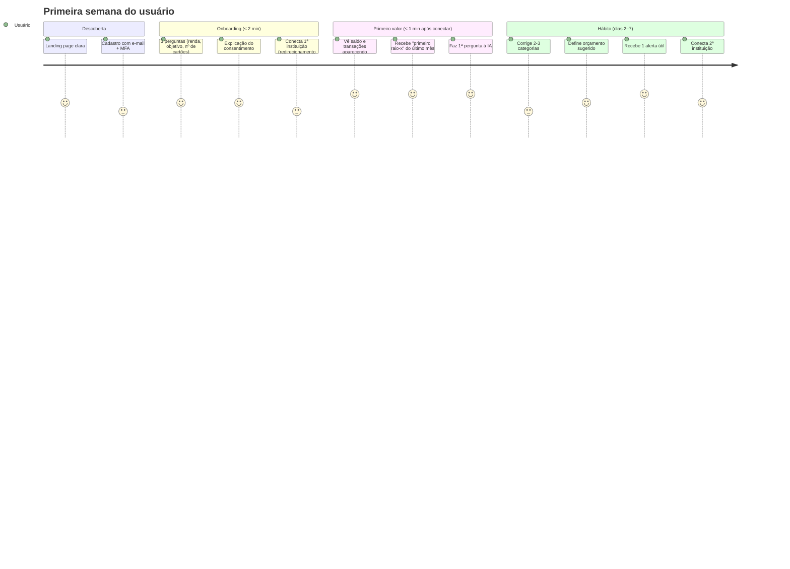
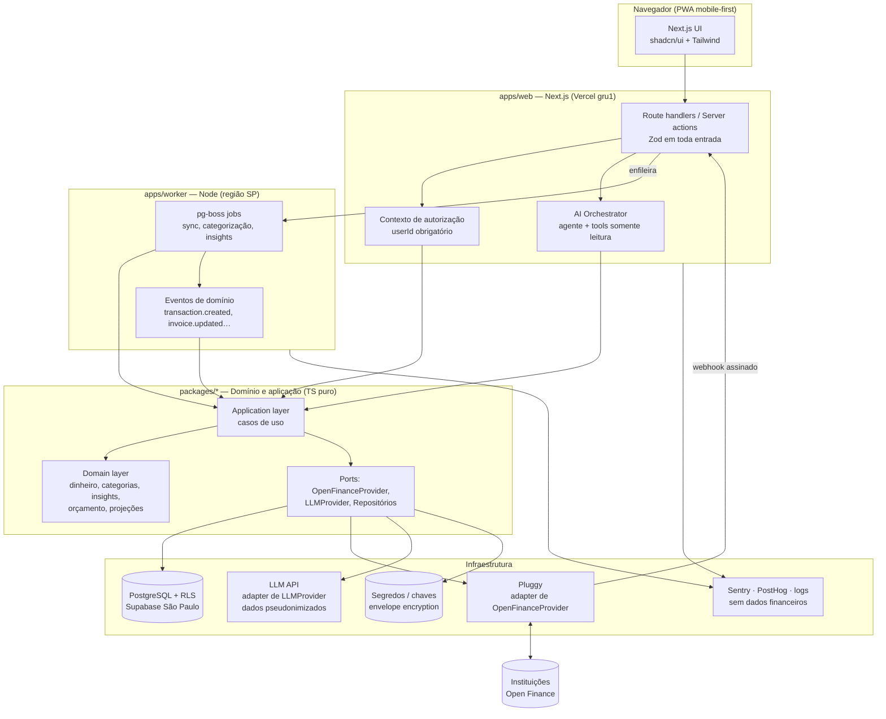
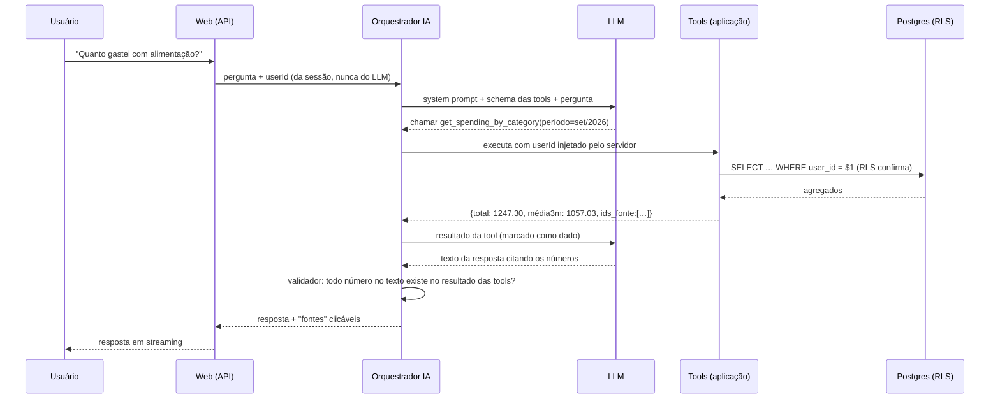

# Fin — Etapa 1 (Product Discovery) + Etapa 2 (Pesquisa técnica)

> Versão 1 · 05/10/2026 · Documento de análise. Nenhum código foi escrito.
> Convenções: **[Fonte n]** remete à lista no final. **[Inferência]** marca conclusões minhas, não afirmadas pelas fontes.
> ⚖️ = **“Isso precisa ser validado com jurídico/compliance especializado.”**

---

## 0. Resumo executivo

1. **O produto faz sentido e o mercado está maduro.** O Open Finance Brasil passou de 240 milhões de consentimentos (set/2026, alta de 54% em 12 meses) [Fonte 14]. A categoria “IA financeira pessoal” já tem um player forte: o **Pierre** (CloudWalk), nota 4,8 com 7.200+ avaliações na App Store e planos pagos [Fonte 16]. Não estamos inventando a categoria; precisamos **executar melhor em um recorte**.
2. **O maior risco não é técnico, é de custo e regulação.** Uma empresa sem licença do Banco Central **não pode participar diretamente** do Open Finance [Fonte 9]; precisa de um agregador autorizado. O mais barato com preço público (Pluggy) cobra **a partir de R$ 2.500/mês** em produção [Fonte 1]. O sandbox é grátis e sem prazo [Fonte 1]. Isso muda a monetização (seção 1.9).
3. **Princípio de arquitetura nº 1: a IA nunca calcula dinheiro.** Todo número sai de código determinístico e testado (domínio). A IA escolhe ferramentas, interpreta e explica. Isso resolve ao mesmo tempo “não inventar dados”, testabilidade e auditoria.
4. **Recomendação de stack:** monorepo TypeScript com Next.js (web) + worker Node separado (sincronização, insights) + PostgreSQL com Row Level Security, hospedados na **região São Paulo**; Open Finance via **Pluggy atrás de uma interface `OpenFinanceProvider`**; IA via API de LLM atrás de uma interface própria, com dados pseudonimizados.
5. **Antes de código, preciso de 6 decisões suas** (seção 4). Todas têm recomendação.

---

---

> ## 🔄 Atualização 05/10/2026 — escopo mudou para USO PESSOAL
>
> Kai decidiu que o app será **só para uso próprio**, para não ter custo de Open Finance.
>
> - **D1 resolvida:** Meu Pluggy (grátis, até 5 conexões, mesmo titular, atualização automática a cada 24h) [Fonte 18]. Proibido usar com contas de terceiros.
> - ⚠️ **Janela de 15 dias:** segundo a doc do Actual Budget, só é possível conectar contas ao meu.pluggy.ai enquanto o trial do Pluggy Dashboard está ativo; depois, as conexões existentes continuam, mas a lista não pode ser editada [Fonte 19]. **Conectar todos os bancos e cartões de uma vez dentro do trial.** [Inferência] Não está claro o que acontece quando um consentimento expira e precisa ser renovado após o trial; tratar como risco e escolher prazo de consentimento longo ao conectar.
> - **D2 (monetização) deixa de existir.** Saem do escopo: billing, landing page pública, cadastro aberto.
> - **LGPD:** tratamento por pessoa natural para fins exclusivamente particulares e não econômicos fica fora da LGPD (art. 4º, I). Segurança continua obrigatória, pois são dados bancários reais.
> - **Custo esperado:** Pluggy R$ 0; hospedagem em planos gratuitos (Vercel Hobby é para uso pessoal não comercial); o único custo variável é a API do LLM, pago por uso.
> - **D4 revista (IA grátis):** Groq no plano gratuito (ex.: `openai/gpt-oss-120b`: 30 req/min, 1.000 req/dia, 8 mil tokens/min, 200 mil tokens/dia), com Zero Data Retention ativado. Por padrão o Groq não retém dados de inferência e oferece ZDR em todos os planos; dados ficam nos EUA. Gemini no plano gratuito **descartado para dados bancários**: os termos dizem que o Google usa o conteúdo para melhorar produtos, com revisão humana, e pedem para não enviar informação pessoal ou sensível. Fontes: https://console.groq.com/docs/your-data · https://console.groq.com/docs/rate-limits · https://ai.google.dev/gemini-api/terms
> - **Caixinhas no MVP (leitura):** a Pluggy informa que caixinhas do Nubank e cofrinhos do PicPay são CDBs e aparecem na seção de investimentos da conexão Open Finance; Nubank é coberto (https://docs.pluggy.ai/docs/investments-open-finance-coverage).
> - **D5 revista:** a IA pode **criar dentro do app** plano de gastos, orçamento e reservas, sempre com confirmação do usuário antes de salvar.
> - **Mover dinheiro automaticamente: fora do MVP.** O Open Finance tem iniciação de Pix e "transferências inteligentes" entre contas do mesmo titular (2024), mas só via instituição autorizada; o Meu Pluggy é só leitura e o produto de Pagamentos da Pluggy custa a partir de R$ 500/mês (Fonte 1). [Inferência] O Pix cai no saldo da conta, não direto numa caixinha. No MVP, a IA calcula quanto separar quando o salário cai e avisa; o usuário move no app do banco.
> - **Arquitetura mantida** (camadas, `OpenFinanceProvider`, isolamento por usuário), para que abrir para outras pessoas no futuro seja possível trocando o plano do agregador, sem reescrever.

---

# ETAPA 1 — PRODUCT DISCOVERY

## 1.1 A pergunta-guia

“Se eu tivesse um excelente analista financeiro acompanhando minha vida financeira todos os dias, o que ele faria por mim?”

Um bom analista humano faz cinco coisas, nesta ordem de valor:

| #   | O que o analista faz                                | Tradução em produto                              | Quando entra         |
| --- | --------------------------------------------------- | ------------------------------------------------ | -------------------- |
| 1   | **Organiza** tudo num lugar só, sem eu digitar nada | Conexão Open Finance + categorização automática  | MVP                  |
| 2   | **Me explica** o que aconteceu e por quê            | Resumo do mês + chat com IA sobre os meus dados  | MVP                  |
| 3   | **Me avisa** antes de dar problema                  | Alertas: fatura alta, saldo baixo, gasto incomum | MVP (básico) → V2/V3 |
| 4   | **Me diz o que fazer**                              | Recomendações acionáveis, orçamento sugerido     | MVP (orçamento) → V2 |
| 5   | **Planeja comigo**                                  | Metas, simuladores, fluxo de caixa projetado     | V2                   |

**[Inferência]** O item 3 (avisar antes) é o que gera hábito e retenção. O item 2 é o que gera o “uau” da primeira sessão. O MVP precisa entregar o uau na primeira sessão e pelo menos um aviso útil na primeira semana.

## 1.2 Proposta de valor

**Para** jovens profissionais assalariados com várias contas e cartões,
**que** não sabem para onde o dinheiro vai e se sentem ansiosos com a fatura,
**o Fin é** um analista financeiro pessoal com IA
**que** conecta suas contas, entende seus gastos e diz, em linguagem simples, o que aconteceu, se é bom ou ruim e o que fazer.
**Diferente de** apps de planilha (Mobills, Organizze) que exigem disciplina de registrar e mostram gráficos sem interpretação,
**o Fin** responde perguntas reais (“posso comprar isso?”) com números verificáveis dos seus próprios dados.

Frase de produto: **“Finalmente entendi minha vida financeira. Agora sei o que fazer.”**

## 1.3 Diferencial (e onde não vamos conseguir diferenciar)

O que **não** é diferencial (todo concorrente tem ou terá): ter Open Finance, ter dashboard, ter categorização, ter um chat.

Onde podemos diferenciar **[Inferência]**:

1. **Confiabilidade verificável.** Toda resposta da IA mostra de onde veio cada número (“baseado em 47 transações de set/2026, toque para ver”). Nenhum número inventado. É raro e é o que constrói confiança num produto que lê dados bancários.
2. **Foco no cartão de crédito e no “quanto posso gastar”.** Para o público-alvo, o cartão é onde o dinheiro some (parcelas, fatura que já nasce comprometida). Uma resposta precisa a “quanto da próxima fatura já está comprometido?” vale mais que dez gráficos.
3. **Proatividade com pouca notificação.** Poucos alertas, todos com ação clara. O padrão do mercado é notificar demais.
4. **Explicação, não julgamento.** Tom calmo, não punitivo (seção 31 do seu pedido).
5. **Transparência de privacidade como feature.** Tela clara de “o que o Fin vê, o que a IA vê, como apagar tudo”.

## 1.4 Público-alvo e personas

Recorte inicial recomendado (mais estreito que a lista original, para o MVP acertar o tom e as features):

**Persona principal — “Ana, 28, CLT”**

- Salário mensal fixo, 2–3 contas (banco tradicional + digital), 2 cartões.
- Dor: “Ganho bem, mas no fim do mês não sobra. Não sei onde vai.” Fatura sempre maior do que esperava.
- Quer: saber quanto pode gastar, parar de se surpreender com a fatura, começar uma reserva.

**Persona secundária — “Bruno, 33, quer sair das dívidas”**

- Parcelas acumuladas, rotativo ocasional.
- Quer: ver o tamanho real do compromisso futuro e um plano.
- ⚠️ Cuidado: persona endividada é sensível. Tom não julgador é obrigatório; recomendações de crédito específicas ficam fora do MVP.

**Fora do MVP:** autônomos com renda variável (fluxo de caixa difícil), investidores avançados (exigem dados de investimento e trazem risco regulatório CVM, seção 2.8), PJ.

## 1.5 Principais problemas do usuário (jobs to be done)

| Problema                                    | Frequência | Dor                   | Resolvido em                                   |
| ------------------------------------------- | ---------- | --------------------- | ---------------------------------------------- |
| “Não sei para onde o dinheiro vai”          | Mensal     | Alta                  | MVP: categorização + resumo                    |
| “A fatura me surpreende”                    | Mensal     | Muito alta            | MVP (fatura atual) / V2 (parcelas futuras)     |
| “Não sei quanto posso gastar até o salário” | Semanal    | Alta                  | MVP (estimativa simples) / V2 (fluxo de caixa) |
| “Tenho assinaturas que esqueci”             | Ocasional  | Média, mas gera “uau” | V2 (recorrências)                              |
| “Posso fazer essa compra?”                  | Ocasional  | Alta no momento       | MVP (simulação simples via chat) / V2          |
| “Quero juntar dinheiro para X”              | Contínua   | Média                 | V2 (metas)                                     |
| “Estou endividado”                          | Contínua   | Muito alta            | V2/V3                                          |

## 1.6 Principais funcionalidades (mapa completo)

Agrupadas pelos 5 papéis do analista:

- **Organizar:** conexões Open Finance, contas, saldos, transações, cartões, faturas, parcelas, empréstimos, investimentos, categorização automática com aprendizado, recorrências.
- **Explicar:** dashboard “o que aconteceu / por quê / bom ou ruim / o que fazer”, resumo mensal, chat com IA, gastos por categoria, comparação com média.
- **Avisar:** insights e alertas (gasto incomum, fatura alta, saldo baixo, duplicidade, cobrança recorrente nova, risco de caixa).
- **Recomendar:** orçamento sugerido, oportunidades de economia, “qual cartão usar” (V3, depende de dados de benefícios que o Open Finance não traz bem).
- **Planejar:** metas, simuladores (compra, parcelamento, corte de despesa), fluxo de caixa projetado, patrimônio líquido.

## 1.7 Jornada do usuário

Momentos críticos de abandono **[Inferência]**:

1. **Redirecionamento ao banco** (o usuário sai do app). Mitigar explicando antes, com linguagem simples, o que vai acontecer.
2. **Espera da primeira sincronização.** O histórico pode levar de segundos a minutos. Mitigar com tela de progresso que já mostra o que chegou e o “raio-x” assim que houver dados.
3. **Categorização errada na primeira impressão.** Se “Ifood” aparece como “Outros”, a confiança cai. Mitigar com regras curadas para os ~300 merchants mais comuns antes do lançamento.

## 1.8 MVP, V2, V3

### MVP (proposta, ajustada a partir da sua lista)

| #       | Item                                                              | Observação                                                                 |
| ------- | ----------------------------------------------------------------- | -------------------------------------------------------------------------- |
| 1–3     | Cadastro, login, onboarding curto                                 | MFA (TOTP) disponível desde o início                                       |
| 4       | Conexão Open Finance **em sandbox**                               | Via Pluggy (decisão D1)                                                    |
| 5–6     | Importação de contas e transações                                 | Sincronização em background + webhooks                                     |
| 7       | Categorização                                                     | Regras + categoria do provedor + correção do usuário que aprende           |
| 8–9     | Dashboard + resumo financeiro                                     | Receitas, despesas, saldo, comparação com média                            |
| 10      | Chat com IA                                                       | Agente + tools, somente leitura, números do domínio                        |
| 11      | Insights                                                          | 4 tipos: aumento de categoria, transação incomum, saldo baixo, fatura alta |
| 12      | Orçamento simples                                                 | Mensal por categoria, com sugestão baseada na média                        |
| **+13** | **Cartão: fatura atual e limite** (proposta de inclusão)          | Decisão D6. Vem no mesmo consentimento; alto valor para a persona          |
| **+14** | **Segurança e privacidade: desconectar, exportar e apagar dados** | Não é opcional: LGPD (direitos do titular, art. 18) ⚖️                     |

Fora do MVP de propósito: landing page elaborada (uma página simples basta), patrimônio, investimentos, metas, simuladores dedicados (o chat cobre “posso comprar?” de forma simples), IA proativa por eventos, notificações push/e-mail (só in-app no MVP).

### V2

Cartões completos (parcelas futuras, próximas faturas), recorrências e assinaturas, metas, fluxo de caixa projetado com alerta de risco, simuladores com cenários (atual/otimista/conservador), notificações por e-mail/push, IA proativa para os 3 eventos mais valiosos (salário recebido, fatura fechada, gasto incomum), billing (assinaturas pagas).

### V3

Investimentos e patrimônio líquido, empréstimos e financiamentos, previsões avançadas, IA proativa completa (motor de eventos), automações, relatórios, app nativo (se métricas justificarem), “qual cartão usar”.

## 1.9 Monetização — análise

**O fato que muda tudo:** em produção, cada usuário conectado custa dinheiro. Pluggy: mínimo de R$ 2.500/mês, com cobrança por requisição acima do mínimo [Fonte 1]. Belvo: US$ 1.000/mês no plano Launch [Fonte 3]. Um desenvolvedor relatou em maio/2026 exatamente esse bloqueio para app de finanças pessoais (Pluggy ~R$ 2,5k, Belvo ~R$ 6k, Tecnospeed R$ 1,5k de entrada + R$ 540/mês) [Fonte 2].

**Conta de padaria [Inferência]:** com um plano Pro a R$ 29,90/mês, cerca de **84 assinantes pagantes** cobrem só o mínimo da Pluggy (antes de impostos, taxas de pagamento, LLM e infra). Um plano Free com Open Finance ilimitado queima caixa sem receita.

Referência de mercado: o Pierre cobra assinaturas na App Store com faixas de R$ 39 a R$ 399 (Pro) e R$ 199 a R$ 1.999 (Premium) [Fonte 16]. **[Inferência]** pela proporção ~10x, os valores maiores são provavelmente anuais.

**Opção A — Freemium (seu modelo original):** Free com dashboard e conexão limitada, Pro com IA, Premium com planejamento.

- Prós: topo de funil grande.
- Contras: o Free ainda consome requisições pagas de Open Finance e tokens de LLM. Precisa de muito volume para converter.

**Opção B — Trial + pago (sem Free com Open Finance):** 14 dias com tudo liberado, depois Pro (~R$ 24,90–29,90/mês ou anual com desconto). Um plano Free sem conexão automática (importação manual de extrato OFX/CSV) pode existir como porta de entrada barata.

- Prós: cada usuário com Open Finance paga o próprio custo; o Free OFX custa quase nada.
- Contras: topo de funil menor; OFX tem atrito.

**Recomendação: Opção B.** Pro único no lançamento (simplicidade), Premium só quando houver features de V3 que o justifiquem.
**Motivo:** o custo variável por usuário conectado é real e o mínimo mensal é alto para uma startup. É mais fácil abrir um Free depois do que tirar features de quem já usa.

---

# ETAPA 2 — PESQUISA TÉCNICA

## 2.1 Open Finance Brasil: o que é, hoje

- **Base normativa** (vigente, segundo levantamento de [Fonte 7], vendor, conferido com [Fonte 8] e [Fonte 9]):
  - Resolução Conjunta nº 1/2020 (cria o sistema, princípios e participação) [Fonte 8]
  - Circular BCB nº 4.015/2020 (escopo de dados e serviços)
  - Circular nº 4.032/2020 (governança)
  - Resolução BCB nº 32/2020 (requisitos técnicos e operacionais)
  - Resolução Conjunta nº 7/2023 (mudanças de consentimento)
  - Resolução Conjunta nº 10/2024 (amplia participação obrigatória a partir de 01/01/2025)
- **Escala:** 240 milhões de consentimentos de compartilhamento (set/2026, +54% a/a), segundo estudo da Zetta citado em [Fonte 14]. Em janeiro/2026 o número citado era 128 milhões de consentimentos ativos [Fonte 15]. (As fontes usam bases diferentes; trato como ordem de grandeza.)
- **Dados que podem ser compartilhados** (fase de dados de clientes): cadastro, contas (saldo, extrato), cartões de crédito (limites, faturas, transações), operações de crédito (empréstimos, financiamentos), investimentos, câmbio. A disponibilidade real varia por instituição e por consentimento — a Pluggy expõe isso por recurso com status `AVAILABLE`, `PENDING_AUTHORISATION`, `UNAVAILABLE`, `TEMPORARILY_UNAVAILABLE` [Fonte 5]. **Consequência de produto:** a UI precisa tratar “dado não disponível nesta instituição” como estado normal, não erro.
- **Histórico:** o compartilhamento de transações abrange, **no mínimo, os últimos 12 meses** [Fonte 7, citando a norma].
- **Consentimento:** não há teto fixo de 12 meses; o prazo deve ser “compatível com as finalidades” e o cliente pode revogar a qualquer momento por procedimento seguro e ágil [Fonte 7, citando a Res. Conjunta nº 7]. ⚖️ Confirmar prazo e finalidade do nosso consentimento com o jurídico.
- **Limites de consulta:** a rede impõe **limites mensais de frequência de chamadas** por pessoa/tipo de dado [Fonte 4]. O modelo hoje é de _polling_, e estudo citado em [Fonte 14] aponta 61,5% das consultas como desperdício; houve prova de conceito de mensageria em 2025. **Consequência de arquitetura:** sincronização orientada a webhooks do agregador, cache local, nada de “buscar no banco a cada pergunta do chat”.
- **Novidades 2026** (fonte vendor [Fonte 6]): Jornada Sem Redirecionamento para PJ (Res. BCB 541/2025), portabilidade de crédito digital (Res. Conjunta 15/2025), jornada otimizada (Manual de Escopo v7.0). Pouco impacto no nosso MVP PF.

## 2.2 Quem pode acessar os dados (ponto regulatório central)

- **Empresas não autorizadas pelo BC não participam diretamente.** Instituições autorizadas podem firmar parcerias com entidades não supervisionadas, com papéis e responsabilidades definidos, e não podem delegar atendimento a elas [Fonte 9].
- **Na prática do mercado:** empresas de software acessam dados “sem licença própria, desde que por meio de uma instituição autorizada” [Fonte 7, vendor]. A Pluggy declara ser **regulada pelo BC como ITP** (Iniciadora de Transação de Pagamento) [Fonte 1].
- **Debate em aberto (dez/2025):** ITPs agregando dados além da função de pagamento é considerado **lícito** por advogados ouvidos, mas há discussão sobre transparência do consentimento, cadeia de responsabilidade em vazamentos e reciprocidade; o BC estaria **refinando regras de responsabilidade de ITPs e aumentando exigências de capital** [Fonte 10].
- ⚠️ **Risco regulatório real:** nosso acesso depende do modelo de negócio do agregador. Se a regra para ITPs agregadores mudar, o custo ou a viabilidade muda. Mitigação: interface `OpenFinanceProvider` trocável + contrato com cláusulas de continuidade + monitorar normas.
- ⚖️ **Validar com jurídico:** (a) se nosso modelo (cliente de software de um ITP) exige algum registro próprio; (b) quem é controlador e quem é operador de dados na LGPD entre nós e o agregador; (c) texto do consentimento.

## 2.3 Provedores / agregadores

|                    | **Pluggy**                                                                                                                             | **Belvo**                                                          | **Tecnospeed**                                                      | **Klavi**                                                                        | **Ser participante direto**    |
| ------------------ | -------------------------------------------------------------------------------------------------------------------------------------- | ------------------------------------------------------------------ | ------------------------------------------------------------------- | -------------------------------------------------------------------------------- | ------------------------------ |
| Status regulatório | ITP regulada pelo BC [F1]                                                                                                              | Opera sob regras do Open Finance regulado [F4]                     | Não verificado                                                      | Acesso via parceria com Iniciador; aguardava licença ITP própria (2023–25) [F11] | Exige autorização do BC [F9]   |
| Preço de entrada   | **R$ 2.500/mês** (Dados) + por requisição acima do mínimo [F1]                                                                         | **US$ 1.000/mês** (Launch); Growth sob consulta [F3]               | R$ 1.500 entrada + R$ 540/mês (relato de usuário, não oficial) [F2] | Sob consulta; foco B2B crédito/KYC [F11]                                         | Inviável para startup [F2, F9] |
| Sandbox            | **Grátis, sem prazo**, dados sintéticos com contas, cartões, investimentos, empréstimos, parcelas; inclui fluxo Open Finance [F1, F12] | Grátis, “Mockbank” [F3, F4]                                        | Não verificado                                                      | Não verificado                                                                   | —                              |
| Trial produção     | 15 dias, sem cartão, contas reais [F1]                                                                                                 | Não informado                                                      | Não verificado                                                      | —                                                                                | —                              |
| Dados              | Contas, transações, cartões/faturas, investimentos, empréstimos, identidade [F12, F5]                                                  | Owners, contas, transações, faturas, investimentos [F4]            | Foco ERP/PJ [F13]                                                   | Crédito, KYC, fraude [F11]                                                       | —                              |
| Categorização      | Sim, com IA, árvore hierárquica, regras customizadas e correção via API [F17]                                                          | Não avaliado                                                       | —                                                                   | —                                                                                | —                              |
| Widget de conexão  | Connect Widget                                                                                                                         | Hosted Widget + portal de gestão de consentimentos “My Belvo” [F4] | —                                                                   | —                                                                                | —                              |
| Plano grátis       | “Meu Pluggy”: **só uso pessoal** (até 5 conexões, mesmo titular); **proibido para produto de terceiros** [F18]                         | —                                                                  | —                                                                   | —                                                                                | —                              |

**Observações importantes:**

- A Pluggy tem também “acesso direto” (conectores não-Open Finance). **[Inferência]** Recomendo usar **somente conectores Open Finance regulados** para reduzir risco jurídico e de segurança (não pedir senha bancária ao usuário).
- O sandbox da Pluggy **não deve ser alvo de testes automatizados** que dependam do comportamento dela [F12]. Então nossos testes usam um **`FakeOpenFinanceProvider`** próprio com fixtures; o sandbox serve para testes manuais/integração exploratória.
- Itens/conexões expiram se o acesso for revogado ou o token expirar [F19]. A UI precisa de fluxo de “reconectar”.

**Decisão D1 — Agregador**

- **Opção A: Pluggy.** Preço público em reais, sandbox grátis e ilimitado, trial em produção de 15 dias, categorização inclusa, docs abertas.
- **Opção B: Belvo.** Plano Launch em dólar (~US$ 1.000/mês), portal de consentimento pronto, presença LatAm.
- **Recomendação: Opção A (Pluggy) no MVP, atrás da interface `OpenFinanceProvider`.**
- **Motivo:** menor custo de entrada, cobrança em reais (sem risco cambial) e sandbox completo para construir o MVP inteiro sem gastar. A abstração mantém a troca possível; reavaliar Belvo e outros na hora de ir para produção com cotação formal.

## 2.4 LGPD e proteção de dados

- **Dados financeiros** não estão na lista de “dados sensíveis” do art. 5º, II da LGPD, mas são de alto risco e cobertos por dever de segurança (art. 46) e sigilo. **[Inferência]** Tratar como sensíveis em todos os controles. ⚖️
- **Sigilo bancário (LC 105/2001):** aplica-se a instituições financeiras; existe literatura sobre a interação LC 105 × LGPD [Fonte 20]. Nosso app não é instituição financeira, mas recebe dados protegidos por sigilo via consentimento. ⚖️ Validar obrigações contratuais repassadas pelo agregador.
- **Base legal:** consentimento (Open Finance) + execução de contrato (o serviço contratado). ⚖️
- **Direitos do titular (art. 18):** acesso, correção, portabilidade, eliminação, revogação do consentimento. **Produto:** telas de exportar dados e apagar conta no MVP, com exclusão real (não só soft delete) após prazo de retenção definido pelo jurídico.
- **Transferência internacional (art. 33):** usar um LLM hospedado fora do Brasil é transferência internacional. A Resolução CD/ANPD nº 19/2024 aprovou **cláusulas-padrão contratuais**; o prazo para adequar contratos terminou em **23/08/2025** [Fontes 21, 22]. ⚠️ **Antes de enviar dados reais de usuários a um LLM, precisamos de base legal para a transferência (cláusulas-padrão no contrato com o provedor de IA ou consentimento específico).** ⚖️
- **Minimização para a IA [Inferência, design]:** a IA recebe só agregados e transações pseudonimizadas (sem CPF, nome completo, número de conta/cartão). Isso reduz o impacto mesmo com transferência válida.
- **Encarregado (DPO), RIPD (relatório de impacto), política de privacidade, registro de operações:** necessários antes de produção. ⚖️
- **Infra no Brasil:** Supabase tem região São Paulo [Fonte 23]; Vercel tem região `gru1` (São Paulo) para funções, mas o padrão é `iad1` (EUA) e precisa ser trocado explicitamente [Fonte 24]. Manter banco e computação no Brasil reduz transferências e latência.

## 2.5 Segurança (requisitos derivados da pesquisa)

- Webhooks do agregador assinados e validados; idempotência por ID de evento.
- Tokens/IDs de conexão do agregador criptografados em nível de aplicação (envelope encryption com chave em KMS/Vault), além da criptografia em repouso do banco.
- Row Level Security no Postgres como **segunda** barreira; a primeira é autorização na camada de aplicação (todo repositório exige `userId`).
- Nada de dado financeiro em logs, analytics ou Sentry (scrubbing obrigatório; PostHog sem autocapture de texto).
- MFA (TOTP) disponível no MVP; obrigatório para ações sensíveis (desconectar, exportar, apagar).
- Prompt injection: descrições de transações e nomes de merchants são **dados não confiáveis** — vão para o LLM marcados como dados, nunca como instrução; tools de escrita exigem confirmação explícita do usuário fora do LLM.

## 2.6 IA aplicada: o que a pesquisa e a prática indicam

- **Agente + tools, somente leitura no MVP.** Tools retornam números já calculados pelo domínio. O LLM nunca soma transações.
- **Sem RAG/embeddings no MVP [Inferência].** Dados financeiros são estruturados; SQL/tools respondem melhor e com exatidão. Embeddings só se surgir busca semântica (ex.: “aquela compra de presente do mês passado”), e então numa tabela com `user_id` + RLS e filtro obrigatório por usuário.
- **Categorização:** o agregador já entrega categoria com IA e aceita regras e correções [F17]. Nossa camada: regras do usuário > regras curadas > categoria do provedor > LLM barato em lote só para o que sobrar como “Outros”.
- **Modelos:** um modelo forte para o chat e um modelo pequeno/barato para categorização em lote e títulos de insights.

## 2.7 Concorrência

- **Pierre (CloudWalk):** IA financeira com Open Finance, orçamento, categorias, insights; 4,8★ com 7.200+ avaliações; planos Pro e Premium pagos. Usuários pedem **mais planejamento de receitas e despesas projetadas** [Fonte 16]. **[Inferência]** Fluxo de caixa projetado e cartão/parcelas são lacunas exploráveis. A política de privacidade declarada na App Store inclui uso de dados para publicidade [Fonte 16]; posicionar o Fin como “seus dados nunca para anúncios” é um diferencial possível.
- **Guiabolso:** comprado pelo PicPay e encerrado em nov/2022 [Fonte 25]. Lição **[Inferência]**: agregação pura vira commodity; o valor tem de estar na interpretação.
- **Mobills, Organizze e similares:** foco em registro manual/planejamento; IA não é o centro.

## 2.8 Outros pontos regulatórios a destacar

- ⚠️ **Recomendação de investimentos:** consultoria e análise de valores mobiliários são atividades reguladas pela CVM. **A IA não deve recomendar ativos, fundos ou corretoras específicas.** Pode explicar conceitos e simular aportes genéricos. ⚖️
- ⚠️ **Crédito:** sugerir “pegue o empréstimo X” pode configurar correspondente/intermediação. Fora do escopo. ⚖️
- ⚠️ **Código de Defesa do Consumidor:** projeções devem vir com aviso de que não são garantia (você já pediu isso). Termos de uso claros.
- ⚠️ **Publicidade e uso secundário de dados:** só com finalidade consentida. ⚖️

## 2.9 Tecnologias — comparação e escolha

| Camada            | Opção A                                         | Opção B                       | Recomendação                       | Motivo                                                                                     |
| ----------------- | ----------------------------------------------- | ----------------------------- | ---------------------------------- | ------------------------------------------------------------------------------------------ |
| Frontend          | Next.js (App Router) + TS                       | Vite SPA + React              | **Next.js**                        | SSR/streaming para chat, server actions, ecossistema, PWA mobile-first                     |
| UI                | Tailwind + shadcn/ui                            | Chakra/MUI                    | **Tailwind + shadcn/ui**           | Código dos componentes fica no repo (controle total do design system), acessível (Radix)   |
| Backend           | Next.js API (BFF) + worker Node separado        | NestJS separado               | **Next.js + worker** no monorepo   | Menos peças; o worker roda jobs longos (sync, insights) que não cabem em função serverless |
| Fila/jobs         | pg-boss (fila no próprio Postgres)              | Inngest / Trigger.dev (SaaS)  | **pg-boss**                        | Dados sensíveis não saem para mais um terceiro; uma dependência a menos                    |
| Banco             | PostgreSQL (Supabase, região SP)                | Neon / AWS RDS                | **Supabase Postgres em São Paulo** | Postgres gerenciado + RLS + Auth no mesmo lugar, dados no Brasil [F23]                     |
| ORM               | Drizzle                                         | Prisma                        | **Drizzle**                        | SQL explícito, leve, bom com RLS (`SET LOCAL` por transação), migrações em SQL revisáveis  |
| Auth              | Supabase Auth                                   | Clerk / Auth.js (Better Auth) | **Supabase Auth**                  | MFA TOTP, mesma região/banco; Clerk guarda identidades fora do Brasil                      |
| Validação         | Zod                                             | —                             | **Zod**                            | Pedido seu; também valida saídas do LLM e payloads do agregador                            |
| IA                | Anthropic API                                   | OpenAI API                    | Ver D4                             | Ambos viáveis; abstração `LLMProvider`                                                     |
| Analytics         | PostHog (cloud UE ou self-host)                 | Plausible/Umami               | **PostHog sem autocapture**        | Funis e feature flags; configurar para nunca capturar valores                              |
| Erros             | Sentry                                          | —                             | **Sentry com scrubbing**           | Padrão de mercado                                                                          |
| Hospedagem web    | Vercel (`gru1`)                                 | AWS (ECS/Lambda sa-east-1)    | **Vercel no MVP**                  | Velocidade; região SP [F24]. Migrar para AWS se compliance exigir                          |
| Hospedagem worker | Fly.io / Railway (região SP)                    | AWS ECS                       | **Container simples em região SP** | Processo longo, barato no MVP **[Inferência: confirmar região na contratação]**            |
| Testes            | Vitest + Playwright + Testcontainers (Postgres) | Jest                          | **Vitest + Playwright**            | Rápido, TS nativo; Postgres real nos testes de isolamento                                  |

---

# 3. ENTREGÁVEIS FINAIS

## 3.1 Arquitetura recomendada (alto nível)

Fluxo de uma pergunta ao chat:

Regras não negociáveis da arquitetura:

1. `userId` vem **sempre** da sessão autenticada, nunca de parâmetro do LLM ou do cliente.
2. Dinheiro em **centavos inteiros** (`bigint`), nunca `float`.
3. Toda conta financeira mora em `packages/domain`, com testes unitários.
4. O frontend não calcula nada financeiro; só formata.
5. Respostas da IA passam por um **validador de números** antes de chegar ao usuário.

## 3.2 Stack recomendada (resumo)

**Monorepo pnpm + Turborepo**, TypeScript strict:

- `apps/web` — Next.js (App Router), Tailwind, shadcn/ui, PWA
- `apps/worker` — Node + pg-boss
- `packages/domain` — regras financeiras puras (sem I/O)
- `packages/application` — casos de uso
- `packages/db` — Drizzle schema, migrações, políticas RLS
- `packages/openfinance` — `OpenFinanceProvider` + `PluggyProvider` + `FakeProvider`
- `packages/ai` — orquestrador, tools, prompts, guardrails, `LLMProvider`
- `packages/ui` — design system

Serviços: Supabase (Postgres + Auth, São Paulo), Vercel (`gru1`), container do worker em região SP, Pluggy, provedor de LLM, Sentry, PostHog. CI no GitHub Actions: lint, typecheck, testes unitários, testes de isolamento com Postgres real, build.

## 3.3 MVP priorizado

Ordem pensada para ter algo demonstrável cedo e fazer a parte arriscada (dados e isolamento) primeiro:

| Prioridade | Entrega                                                                                               | Por que nessa posição                                           |
| ---------- | ----------------------------------------------------------------------------------------------------- | --------------------------------------------------------------- |
| P0         | Fundação: monorepo, CI, auth + MFA, schema base, RLS, **testes User A × User B**                      | Segurança como requisito de primeira classe; tudo depende disso |
| P0         | `OpenFinanceProvider` + Pluggy sandbox + Fake; sincronização de contas e transações via webhook + job | É o dado que alimenta tudo                                      |
| P0         | Categorização (regras + provedor + correção que aprende)                                              | Sem categoria certa, dashboard e IA perdem valor                |
| P1         | Dashboard + resumo do mês (o que aconteceu / por quê / bom ou ruim)                                   | Primeiro “uau”                                                  |
| P1         | Chat com IA (6–8 tools de leitura + validador de números)                                             | Diferencial do produto                                          |
| P1         | Cartão: fatura atual e limite (se D6 = sim)                                                           | Maior dor da persona                                            |
| P2         | Insights (4 tipos)                                                                                    | Proatividade inicial, in-app                                    |
| P2         | Orçamento simples com sugestão                                                                        | Transforma insight em ação                                      |
| P2         | Privacidade: desconectar, exportar, apagar conta                                                      | Obrigação LGPD antes de qualquer usuário real                   |
| P3         | Onboarding polido + landing simples                                                                   | Antes do beta fechado                                           |

## 3.4 Roadmap de desenvolvimento

Sem estimativas de calendário: dependem do seu ritmo de revisão. Cada fase termina com algo que você consegue abrir e testar.

```mermaid
flowchart LR
    F0[Fase 0<br/>Arquitetura detalhada<br/>Etapas 3–6 + aprovação] --> F1[Fase 1<br/>Fundação + segurança<br/>auth, RLS, CI, testes de isolamento]
    F1 --> F2[Fase 2<br/>Open Finance sandbox<br/>sync contas/transações/cartões]
    F2 --> F3[Fase 3<br/>Categorização +<br/>dashboard + resumo]
    F3 --> F4[Fase 4<br/>Chat IA com tools<br/>+ validador]
    F4 --> F5[Fase 5<br/>Insights + orçamento<br/>+ privacidade LGPD]
    F5 --> F6[Fase 6<br/>Revisão jurídica +<br/>beta fechado em produção]
    F6 --> V2[V2<br/>parcelas, recorrências,<br/>metas, fluxo de caixa, billing]
    V2 --> V3[V3<br/>investimentos, patrimônio,<br/>IA proativa, automações]
```

A **Fase 6** é onde o custo começa (Pluggy em produção, revisão jurídica). Até a Fase 5, o custo é praticamente só LLM em desenvolvimento e infra gratuita/barata.

## 3.5 Estimativa de complexidade por módulo

Escala: **P** pequena · **M** média · **G** grande · **GG** muito grande (relativa, não em dias).

| Módulo                      | MVP     | Complexidade | Por quê                                                                                                    |
| --------------------------- | ------- | ------------ | ---------------------------------------------------------------------------------------------------------- |
| auth / users                | ✓       | M            | MFA, sessões, exclusão de conta real                                                                       |
| openfinance                 | ✓       | **GG**       | Consentimento, webhooks, idempotência, reconexão, dados parciais por instituição, limites de chamada       |
| accounts                    | ✓       | P            | Leitura e normalização                                                                                     |
| transactions                | ✓       | G            | Deduplicação, transações pendentes que mudam, transferências entre contas próprias (não contar como gasto) |
| categories                  | ✓       | G            | Hierarquia, regras, aprendizado por usuário, curadoria de merchants                                        |
| cards / invoices            | parcial | G            | Fatura aberta vs fechada, parcelas, estornos                                                               |
| budgets                     | ✓       | M            | Simples no MVP                                                                                             |
| ai (chat + tools)           | ✓       | **GG**       | Orquestração, guardrails, validador de números, prompt injection, custo de tokens, testes                  |
| insights                    | ✓       | G            | Regras estatísticas, deduplicação de alertas, relevância                                                   |
| notifications               | in-app  | P → M        | In-app no MVP; push/e-mail na V2                                                                           |
| analytics / observabilidade | ✓       | M            | Scrubbing de dados sensíveis                                                                               |
| audit log                   | ✓       | M            | Imutável, sem dado financeiro em texto                                                                     |
| goals                       | V2      | M            |                                                                                                            |
| cashflow (projeção)         | V2      | G            | Recorrências + parcelas + salário previsto                                                                 |
| recurring                   | V2      | G            | Detecção robusta (valores variam, datas mudam)                                                             |
| investments / net worth     | V3      | G            | Dados heterogêneos; risco CVM                                                                              |
| proactive AI (eventos)      | V3      | G            | Evitar spam; custo de LLM por evento                                                                       |
| billing                     | V2      | M            | Gateway de pagamento                                                                                       |

## 3.6 Principais riscos

| #   | Risco                                                                                 | Tipo              | Impacto | Mitigação                                                                                                                           |
| --- | ------------------------------------------------------------------------------------- | ----------------- | ------- | ----------------------------------------------------------------------------------------------------------------------------------- |
| R1  | Custo de Open Finance (mínimo R$ 2.500/mês + requisições) maior que a receita inicial | Negócio           | Alto    | Modelo trial + pago (D2); sync por webhook e cache para reduzir requisições; beta fechado com o trial de 15 dias                    |
| R2  | Mudança regulatória para ITPs agregadores / dependência do agregador                  | Regulatório       | Alto    | `OpenFinanceProvider` trocável; monitorar BC; ⚖️ jurídico antes de produção                                                         |
| R3  | Vazamento de dados financeiros                                                        | Segurança         | Crítico | RLS + autorização em app + criptografia de tokens + testes de isolamento no CI + sem dados em logs + pentest antes de produção      |
| R4  | IA inventa ou erra número                                                             | Produto/Confiança | Alto    | Domínio calcula; validador de números; respostas citam fontes; testes de cenários financeiros                                       |
| R5  | Prompt injection via descrição de transação/merchant                                  | Segurança         | Alto    | Dados marcados como não confiáveis; tools só leitura; `userId` injetado pelo servidor; tools de escrita com confirmação fora do LLM |
| R6  | Transferência internacional de dados ao LLM sem base legal                            | LGPD              | Alto    | Cláusulas-padrão ANPD com o provedor, pseudonimização, ⚖️                                                                           |
| R7  | IA “recomenda investimento” → atividade regulada CVM                                  | Regulatório       | Médio   | Guardrail explícito no prompt + testes; ⚖️                                                                                          |
| R8  | Categorização ruim na primeira impressão                                              | Produto           | Médio   | Regras curadas para merchants comuns; correção em 1 toque                                                                           |
| R9  | Dados parciais/atrasados das instituições [F14]                                       | Produto           | Médio   | UI com “atualizado há X”, estados de dado indisponível, nunca afirmar algo que não veio                                             |
| R10 | Concorrente bem financiado (Pierre/CloudWalk)                                         | Mercado           | Médio   | Foco em nicho (cartão + “quanto posso gastar” + confiança verificável); privacidade como posicionamento                             |
| R11 | Custo de LLM por usuário                                                              | Negócio           | Médio   | Modelo pequeno para tarefas em lote; cache de resumos; limites por plano                                                            |

## 3.7 Próximo passo concreto

1. **Você responde às 6 decisões abaixo** (pode ser só “aceito todas as recomendações”).
2. **Você cria duas contas** (eu não posso criar contas nem aceitar termos por você):
   - Pluggy (sandbox gratuito) → Client ID e Client Secret
   - Provedor de LLM escolhido em D4 → chave de API
     As chaves **não** vêm pelo chat; vão como segredos no ambiente quando chegarmos lá.
3. **Eu entrego as Etapas 3–6 em detalhe** (arquitetura com ADRs, schema completo do banco com RLS, todas as telas com estados, desenho da IA com tools/prompts/guardrails) como próximo documento, para sua aprovação.
4. Só depois disso, Fase 1 no repositório, seguindo sua regra: explicar → estrutura → implementar → validar → procurar bugs → corrigir.

---

# 4. DECISÕES QUE PRECISO DE VOCÊ

| #      | Decisão                | Opção A                                                  | Opção B                                                       | Recomendação                                                                                                                                                                                                                                          |
| ------ | ---------------------- | -------------------------------------------------------- | ------------------------------------------------------------- | ----------------------------------------------------------------------------------------------------------------------------------------------------------------------------------------------------------------------------------------------------- |
| **D1** | Agregador Open Finance | **Pluggy** (R$ 2.500/mês, sandbox grátis, trial 15 dias) | Belvo (US$ 1.000/mês)                                         | **A**, atrás de `OpenFinanceProvider`                                                                                                                                                                                                                 |
| **D2** | Monetização            | Freemium com Open Finance no Free                        | **Trial 14 dias + Pro pago**; Free só com import OFX/CSV (V2) | **B** — custo variável por conexão é real                                                                                                                                                                                                             |
| **D3** | Hospedagem e dados     | **Supabase + Vercel, tudo em São Paulo**                 | AWS desde o início                                            | **A** — rápido e com dados no Brasil; migrar se compliance exigir                                                                                                                                                                                     |
| **D4** | Provedor de IA         | **Anthropic**                                            | OpenAI                                                        | **A**, atrás de `LLMProvider` (trocável). Motivo: qualidade de uso de tools e instruções longas de guardrail. Transparência: eu sou um modelo da Anthropic; por isso a abstração existe e a escolha pode ser revista com testes comparativos dos dois |
| **D5** | Escopo da IA no MVP    | Leitura + escrita (criar orçamento/meta pelo chat)       | **Somente leitura**; escrita só por botão com confirmação     | **B** — reduz superfície de ataque de prompt injection                                                                                                                                                                                                |
| **D6** | Cartão no MVP          | Deixar tudo de cartão para V2                            | **Incluir fatura atual + limite no MVP**                      | **B** — maior dor da persona, mesmo consentimento, custo baixo                                                                                                                                                                                        |

Também em aberto, sem urgência: **nome/marca** (“Fin” é provisório?) e **quem será o contato jurídico/compliance** antes da Fase 6.

---

# 5. FONTES

1. Pluggy — Planos e Preços: https://www.pluggy.ai/precos (acessado 05/10/2026)
2. TabNews, GuilhermeVieira, “Estou desenvolvendo um app de finanças pessoais e não consigo pagar o Open Finance…” (21/05/2026): https://www.tabnews.com.br/GuilhermeVieira/estou-desenvolvendo-um-app-de-financas-pessoais-e-nao-consigo-pagar-o-open-finance-pluggy-r2-5k-mes-belvo-r6k-mes-tecnospeed-r1-5k-de-entrada-r540 — relato de usuário, não preço oficial
3. Belvo — Plans and pricing: https://belvo.com/plans-and-pricing/
4. Belvo — Extract Banking Data in Brazil (Widget): https://developers.belvo.com/products/aggregation_brazil/aggregation-brazil-integration-widget
5. Pluggy Docs — Item resources: https://docs.pluggy.ai/en/docs/connections/resources
6. Pluggy Blog — Open Finance 2026: as 4 novidades: https://www.pluggy.ai/blog/open-finance-2026-novidades (fonte vendor)
7. Pluggy Blog — Regulação do Open Finance: as normas que valem hoje: https://www.pluggy.ai/blog/regula%C3%A7%C3%A3o-open-finance (fonte vendor; normas citadas devem ser conferidas no BC)
8. Banco Central — Resolução Conjunta nº 1, de 4/5/2020 (texto consolidado): https://normativos.bcb.gov.br/Lists/Normativos/Attachments/51028/Res_Conj_0001_v7_L.pdf
9. Open Finance Brasil — Modelo de participação: https://openfinancebrasil.org.br/modelo-de-participacao/
10. Finsiders Brasil — “Uso de dados de clientes no Open Finance gera debate no mercado” (16/12/2025): https://finsidersbrasil.com.br/reportagem-exclusiva-fintechs/uso-de-dados-de-clientes-no-open-finance-gera-debate-no-mercado/
11. Finsiders Brasil — “A Klavi agora tem a ‘chave’ do Open Finance regulado” (2023, atualizado 2025): https://finsidersbrasil.com.br/reportagem-exclusiva-fintechs/a-klavi-agora-tem-a-chave-do-open-finance-regulado/
12. Pluggy Docs — Sandbox: https://docs.pluggy.ai/docs/sandbox
13. Tecnospeed — Como funciona o Open Finance para ERPs: https://blog.tecnospeed.com.br/como-funciona-o-open-finance-na-pratica-para-erps/
14. Gradual Investimentos — “Open Finance chega a 240 milhões de consentimentos, mas 61,5% das consultas são desperdício” (01/09/2026, cita estudo Zetta): https://www.gradualinvestimentos.com.br/open-finance-chega-a-240-milhoes-de-consentimentos-mas-615-das-consultas-sao-desperdicio/
15. Contadores.cnt.br — “Open Finance: Brasil lidera ranking global com 128 milhões de consentimentos ativos” (28/01/2026): https://www.contadores.cnt.br/projetos/39/noticias/empresariais/2026/01/28/open-finance-brasil-lidera-ranking-global-com-128-milhoes-de-consentimentos-ativos.html
16. App Store — Pierre: Controle de gastos IA (CloudWalk): https://apps.apple.com/br/app/pierre-controle-de-gastos-ia/id6749781755
17. Pluggy Docs — Transaction Categorization: https://docs.pluggy.ai/docs/transaction-categories
18. Pluggy — Meu Pluggy: https://www.pluggy.ai/meu-pluggy
19. Actual Budget Docs — Pluggy.ai Setup: https://actualbudget.org/docs/advanced/bank-sync/pluggyai/
20. ANBIMA / Mattos Filho — Memorando LC 105 × LGPD × PLD-FT: https://www.anbima.com.br/data/files/3E/F3/0E/8A/C2EF471095F9BF476B2BA2A8/Memorando-LC-105_LGPD_PLD-FT-Mattos-Filho.pdf
21. ANPD — Resolução CD/ANPD nº 19, de 23/08/2024: https://www.gov.br/anpd/pt-br/acesso-a-informacao/institucional/atos-normativos/regulamentacoes_anpd/resolucao-cd-anpd-no-19-de-23-de-agosto-de-2024
22. Kasznar Leonardos — prazo de adequação à Res. ANPD 19/2024 (23/08/2025): https://www.kasznarleonardos.com/en/countdown-30-days-to-comply-with-brazilian-rules-about-international-data-transfer/
23. Supabase — Available regions: https://supabase.com/docs/guides/platform/regions
24. Vercel — Global network and regions: https://vercel.com/docs/regions
25. Finsiders Brasil — “Guiabolso, comprado pelo PicPay, será encerrado em novembro” (2022): https://finsidersbrasil.com.br/noticias-sobre-fintechs/guiabolso-comprado-pelo-picpay-sera-encerrado-em-novembro-finsiders/
26. lgpd.app — Transferência internacional na LGPD (art. 33): https://lgpd.app/transferencia-internacional

**Limitações desta pesquisa:** preços de Tecnospeed e Klavi não são públicos (só relato de terceiros); detalhes de limites de chamadas por instituição não foram levantados; nenhuma conversa comercial com agregadores foi feita. Os números de consentimentos variam entre fontes. Nada aqui é parecer jurídico.
